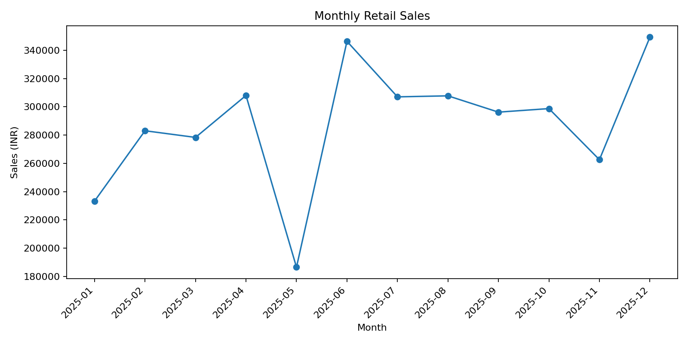
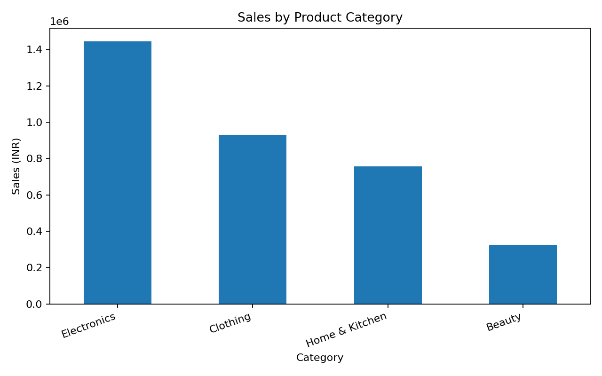
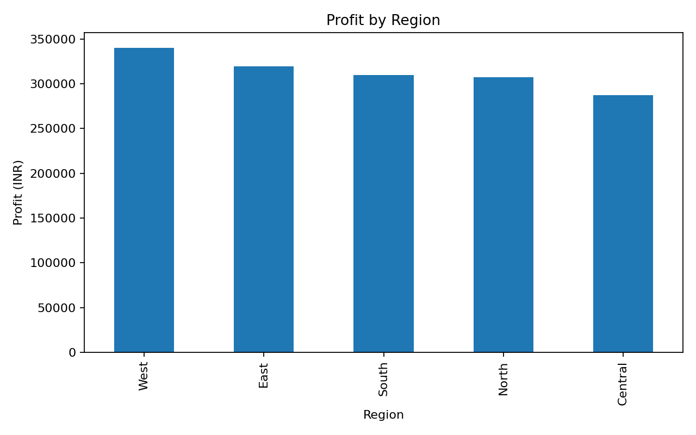
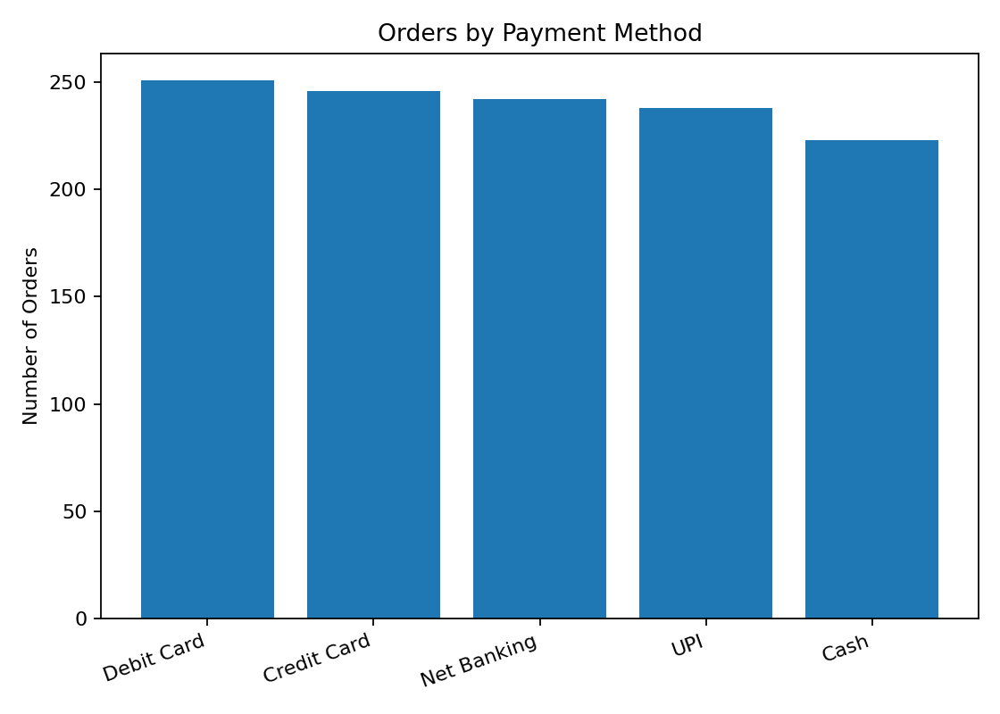

# Retail Sales Analysis | Data Analytics Portfolio Project

A beginner-friendly end-to-end retail analytics project using **Python, SQL, Excel and Power BI**.

> **Dataset notice:** This repository uses a reproducible, synthetic retail dataset generated for learning and portfolio demonstration. It is not real company data and should not be presented as real customer or business results.

## Business problem
A retail business wants to understand sales, profitability, product category performance, regional performance and customer payment preferences. The analysis turns transaction-level data into business KPIs and actionable questions.

## Project objectives
- Measure sales, profit, order volume, units sold and average order value.
- Explore monthly sales trends.
- Compare product categories and regions.
- Understand payment method preferences.
- Build a Power BI dashboard for non-technical stakeholders.

## Tools
- Python: pandas, NumPy, matplotlib
- SQL: SQLite-compatible queries
- Excel: pivot-ready data and summary worksheets
- Power BI: dashboard design and DAX measures

## Repository structure
```text
retail-sales-analysis/
├── data/
│   ├── retail_sales.csv
│   └── retail_sales_analysis.xlsx
├── notebooks/
│   └── retail_sales_analysis.ipynb
├── python/
│   └── analyze_sales.py
├── sql/
│   ├── schema.sql
│   └── analysis_queries.sql
├── powerbi/
│   ├── DAX_measures.txt
│   └── POWER_BI_GUIDE.md
├── visualizations/
│   ├── monthly_sales.png
│   ├── sales_by_category.png
│   ├── profit_by_region.png
│   └── orders_by_payment_method.png
├── requirements.txt
└── README.md
```

## Dataset
The CSV contains 1,200 synthetic order records covering 1 January to 31 December 2025, with fields for order date, customer, region, city, category, product, quantity, price, discount, sales, cost, profit and payment method.

### Key columns
| Column | Meaning |
|---|---|
| Order_ID | Unique order identifier |
| Order_Date | Date of order |
| Customer_ID | Synthetic customer identifier |
| Region / City | Sales geography |
| Category / Product | Product grouping and name |
| Quantity | Units in the order |
| Unit_Price_INR | Price per unit before discount |
| Discount_Rate | Discount fraction (e.g. 0.10 = 10%) |
| Sales_INR | Net sales after discount |
| Cost_INR | Product cost |
| Profit_INR | Sales minus cost |
| Payment_Method | Payment type |

## Initial findings from this generated sample
- Total net sales: **₹3,457,079.55**
- Total profit: **₹1,563,929.55**
- Number of orders: **1,200**
- Units sold: **3,548**
- Average order value: **₹2,880.90**
- Profit margin: **45.24%**
- Highest-sales category in this sample: **Electronics**
- Highest-profit region in this sample: **West**
- Most-used payment method in this sample: **Debit Card**

These findings describe only this synthetic sample. They are not market facts or evidence about a real retailer.

## Visualizations

### Monthly sales


### Sales by category


### Profit by region


### Orders by payment method


## Run the Python analysis
1. Install Python 3.10 or later.
2. Download or clone this repository.
3. Open a terminal in the repository folder.
4. Install dependencies:
   ```bash
   pip install -r requirements.txt
   ```
5. Run:
   ```bash
   python python/analyze_sales.py
   ```
The script prints data-quality checks and KPIs, creates summary CSV files and refreshes charts in `visualizations/`.

## Run the SQL analysis
Import `data/retail_sales.csv` into SQLite as a table named `retail_sales`, then run queries from `sql/analysis_queries.sql`. You can use DB Browser for SQLite or another SQLite client.

## Build the Power BI dashboard
Follow `powerbi/POWER_BI_GUIDE.md`. The repository includes DAX measures and a suggested one-page layout. The `.pbix` file is not pre-generated; create and save it in Power BI Desktop after following the guide.

## Business recommendations to investigate
- Check whether the highest-revenue category also has the strongest profit margin.
- Compare regional profit, not just revenue, before deciding where to invest.
- Review monthly peaks and dips alongside promotions or seasonality (not included in this synthetic dataset).
- Explore whether discounts increase order volume enough to justify lower per-order margin.
- Consider customer-level repeat purchase analysis before designing retention campaigns.

## Limitations
- Synthetic data; no real business conclusions can be drawn.
- The dataset is designed for learning, not statistical inference.
- No inventory, returns, shipping, tax or marketing-spend fields are included.
- Customer identifiers are simulated.

## Author
Add your name, LinkedIn URL and GitHub profile here before publishing.

## License
This project is shared for educational and portfolio use. You may add an MIT License if you want to permit reuse with attribution.
